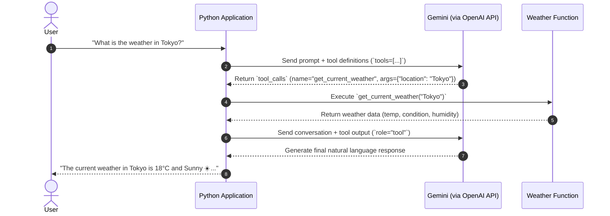

# Day 05: Tool Calling (Function Calling)

Tool calling empowers Large Language Models (LLMs) to interact with external tools, APIs, and databases. Instead of guessing or hallucinating real-time data, the LLM determines when a tool is needed, extracts the required arguments, and lets your application execute the tool before generating a final response.

---

## 🔄 The Tool Calling Lifecycle



---

## 📁 Files in This Directory

| File | Description |
| :--- | :--- |
| [`tool_calling.py`](file:///c:/Users/ATTA%20UR%20REHMAN/Desktop/RAG_JOURNEY/day_05_tool_calling/tool_calling.py) | Standalone script with weather tool definition, JSON schema, dispatcher, and batch demo tests. |
| [`main.py`](file:///c:/Users/ATTA%20UR%20REHMAN/Desktop/RAG_JOURNEY/day_05_tool_calling/main.py) | Interactive CLI chatbot demonstrating multi-turn chat with visual tool calling indicators. |

---

## 🚀 How to Run

Make sure your virtual environment is activated:
```powershell
.\.venv\Scripts\Activate.ps1
```

### 1. Run the Standalone Demo
```powershell
python .\day_05_tool_calling\tool_calling.py
```

### 2. Run the Interactive Chatbot
```powershell
python .\day_05_tool_calling\main.py
```

